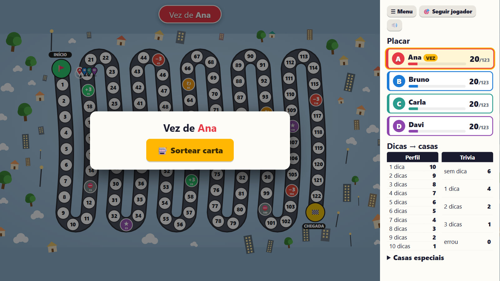
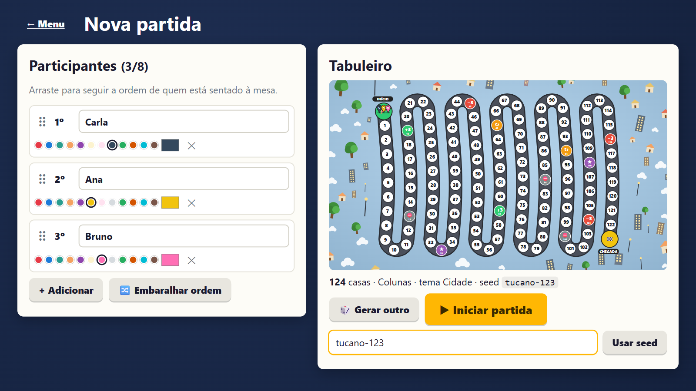
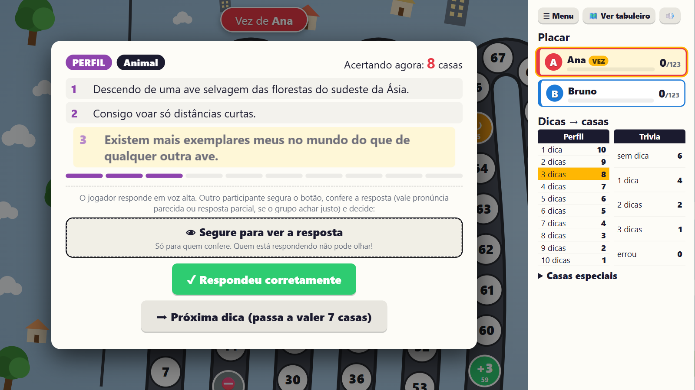
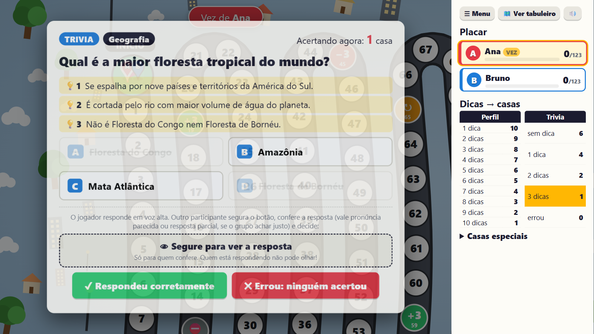

# 🎲 Perfil Trivia

**Jogo de tabuleiro para jogar em grupo numa única tela, seja notebook ou TV. Mistura adivinhação por dicas (estilo "Perfil") com perguntas de trivia. Em português do Brasil, sem cadastro, sem servidor e sem anúncios.**

Não tem dado: **quanto menos dicas você precisar para acertar, mais casas você anda.** Arriscar cedo vale muito. Esperar mais dicas é seguro, mas lento. Essa é a graça do jogo.



## ✨ Destaques

- 🗺️ **Tabuleiro novo a cada partida.** São de 120 a 140 casas, 5 traçados (serpente, colunas, trilha sinuosa, espiral, ilhas com pontes) e 6 temas (floresta, espaço, oceano, deserto, cidade, doces), tudo desenhado em SVG por código. Cada tabuleiro tem uma *seed*: digite a mesma seed para jogar o mesmo tabuleiro de novo.
- 🃏 **1.068 cartas em PT-BR.** São **540 perfis** (Pessoa, Lugar, Coisa, Ano/Evento, Personagem, Animal) e **528 perguntas de trivia** (Geografia, História, Ciência, Esportes, Entretenimento, Tecnologia, Artes, Brasil), com dificuldade variada e muita cultura brasileira.
- 👁️ **Quem confere é o grupo.** Um participante segura o botão *"Segure para ver a resposta"*, que só mostra a resposta enquanto está pressionado, e decide se vale. O grupo pode aceitar pronúncia parecida ou resposta parcial.
- ⭐ **Casas especiais:** avance 3, volte 3, perca a vez, jogue de novo e escolha livre.
- 📚 **Banco de perguntas editável.** Dá para criar, editar, filtrar e apagar cartas e categorias, e importar e exportar JSON.
- 💾 **Partida salva automaticamente.** Feche o navegador e continue depois.
- 📺 **Feito para ser visto de longe.** Tem letras grandes, câmera que acompanha o jogador da vez, sons que podem ser desligados e layout responsivo, que também funciona no celular.

| Configuração da partida | Carta de Perfil | Carta de Trivia |
|---|---|---|
|  |  |  |

## 🚀 Como rodar

Requer [Node.js](https://nodejs.org/) 18 ou mais novo.

```bash
git clone https://github.com/igorhc/perfilTrivia.git
cd perfilTrivia
npm install
npm run dev        # abre em http://localhost:5173
```

Outros comandos:

```bash
npm test           # testes da lógica (Vitest)
npm run build      # versão de produção em dist/
npm run preview    # serve o build localmente
```

Como não há backend, a pasta `dist/` gerada pelo build pode ser publicada de graça no GitHub Pages, no Netlify, na Vercel, no Cloudflare Pages etc. O banco de perguntas fica no navegador (IndexedDB) e a partida em andamento fica no `localStorage`.

## 🎮 Como jogar

1. **Configure a partida** com 2 a 8 participantes, cada um com nome e cor. Arraste os nomes para seguir a ordem em que estão sentados, ou embaralhe. Gere tabuleiros até o grupo gostar de um.
2. **Na sua vez**, uma roleta sorteia o tipo da carta: **Perfil** ou **Trivia**, sempre meio a meio. Escolha a categoria ou clique em **Surpresa**.
3. **Responda em voz alta.** Outro participante segura *"Segure para ver a resposta"* e decide entre **✔ Respondeu corretamente** e **➡ Próxima dica**.
4. O pino anda, o efeito da casa especial é aplicado e a vez passa para o próximo. **Ganha quem chegar primeiro à CHEGADA**, sem precisar cair exatamente nela.

| Perfil (10 dicas, uma por vez) | Casas | Trivia (até 3 dicas) | Casas |
|---|---|---|---|
| acertou vendo **N** dicas | **11 − N** (de 10 a 1) | sem dica | 6 |
| errou o palpite | só abre a próxima dica | 1 dica | 4 |
| passou das 10 dicas | 0 | 2 dicas | 2 |
| | | 3 dicas | 1 |
| | | errou depois da 3ª dica | 0 |

| Casa especial | Efeito |
|---|---|
| **+3** Avance 3 | anda mais 3 casas |
| **−3** Volte 3 | volta 3 casas |
| **⛔** Perca a vez | pula a próxima jogada |
| **↻** Jogue de novo | joga outra vez na hora |
| **★** Escolha livre | na próxima jogada escolhe o tipo da carta e a categoria |

Os efeitos não se encadeiam, e uma carta não se repete na mesma partida.

## 📝 Como adicionar perguntas

**Pela interface:** vá em Menu → **Banco de perguntas**. Lá dá para criar, editar, apagar e filtrar cartas e categorias, e usar **Importar JSON** e **Exportar JSON**. A importação junta as cartas novas às que já existem e ignora as duplicadas, ou seja, perfis com a mesma resposta ou trivias com a mesma pergunta, sem diferenciar maiúsculas e acentos. As cartas inválidas aparecem numa lista.

**Pelo código:** edite `src/data/seed.json` e aumente o campo `version`. Na próxima vez que o jogo abrir, o banco do navegador se atualiza sozinho e as cartas criadas pelo usuário são mantidas.

### Formato do JSON (seed, importação e exportação)

```jsonc
{
  "version": 3,
  "categories": {
    "perfil": ["Pessoa", "Lugar", "Coisa", "Ano/Evento", "Personagem", "Animal"],
    "trivia": ["Geografia", "História", "Ciência", "Esportes", "Entretenimento", "Tecnologia", "Artes", "Brasil"]
  },
  "perfil": [
    {
      "category": "Animal",
      "answer": "Bicho-preguiça",
      "clues": ["dica 1 (a mais difícil)", "…", "dica 10 (quase entrega)"], // EXATAMENTE 10
      "difficulty": "facil"                                                // "facil" | "medio" | "dificil"
    }
  ],
  "trivia": [
    {
      "category": "Geografia",
      "question": "Qual é a capital da Austrália?",
      "type": "multipla",                                     // "multipla" | "aberta"
      "options": ["Sydney", "Canberra", "Melbourne", "Perth"], // só na múltipla: 4 opções
      "answer": "Canberra",                                   // na múltipla, igual a uma das opções
      "hints": ["…", "…", "Não é Sydney nem Perth."],          // de 0 a 3 dicas
      "difficulty": "medio"
    }
  ]
}
```

### Regras de qualidade (verificadas ao salvar e ao importar)

- **Perfil:** exatamente 10 dicas, da mais difícil para a mais fácil. **Nenhuma dica pode só repetir a categoria**, porque o jogador já sabe que escolheu "Pessoa" ou "Lugar". Dicas como *"Sou uma pessoa"*, *"Sou um lugar"*, *"Fui um evento…"*, *"Aconteci no século XIX"* ou *"Pertenço ao folclore brasileiro"* são recusadas. A primeira dica já precisa ser um fato real.
- **Múltipla escolha:** 4 alternativas diferentes, com a resposta entre elas.
- **Trivia:** no máximo 3 dicas. Se faltar alguma, o jogo completa sozinho, eliminando alternativas erradas ou mostrando a primeira letra. Uma dica escrita como *"Não é X nem Y."* risca essas alternativas na tela.

## 🛠️ Tecnologias

[React](https://react.dev/) 18 · [TypeScript](https://www.typescriptlang.org/) · [Vite](https://vitejs.dev/) · [Dexie](https://dexie.org/) (IndexedDB) · [dnd-kit](https://dndkit.com/) · [Vitest](https://vitest.dev/). Não há imagens externas: o tabuleiro, as decorações e os sons são gerados por código (SVG e Web Audio).

```
src/
  logic/          lógica pura, com testes
    board.ts        gerador de tabuleiro (traçados, casas especiais, decorações)
    typeBag.ts      sorteio Perfil/Trivia sempre meio a meio
    scoring.ts      cálculo de casas
    game.ts         movimento, casas especiais, turnos, ranking
    cards.ts        validação, importação, conferência de dicas
    rng.ts          aleatoriedade com seed
  db/db.ts        banco de perguntas (IndexedDB) e atualização automática do seed
  components/     telas: configuração, jogo, cartas, administração, tabuleiro
  data/seed.json  as 1.068 cartas
```

## 🤝 Contribuindo

Contribuições são muito bem-vindas, principalmente **cartas novas** e **correções de fatos**. Abra uma *issue* ou um *pull request*. Antes de enviar, rode `npm test`: um dos testes valida o banco inteiro com as mesmas regras do jogo.

> As cartas foram escritas e revisadas com a ajuda de IA, em várias rodadas de revisão independente. Mesmo assim, algum fato pode ter escapado. Se encontrar um erro, abra uma *issue*.

## 📄 Licença

Distribuído sob a licença **MIT**. Veja o arquivo [LICENSE](LICENSE). Você pode usar, copiar, modificar, distribuir e até vender o jogo, com ou sem alterações, desde que mantenha o aviso de copyright e a licença.
